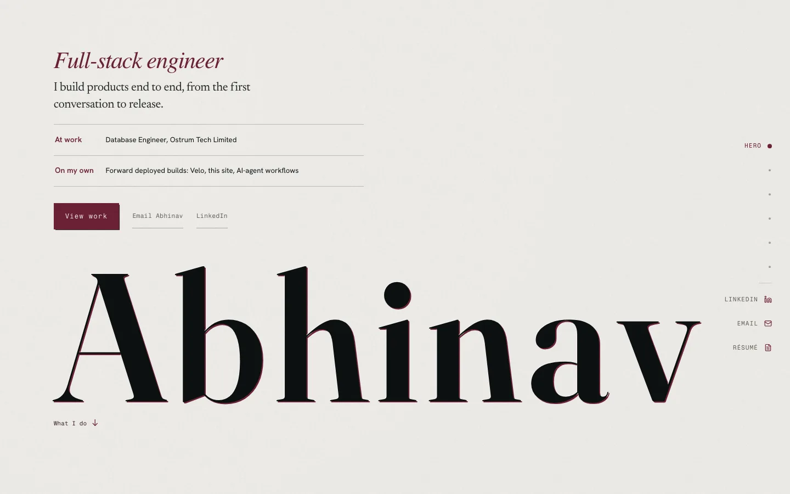

# Abhinav Prasad | Engineering portfolio

A personal engineering portfolio for Abhinav Prasad, built around his software work and independent products.

[View the live site](https://abhinav-prasad-portfolio.vercel.app)



## Highlights

- App Router pages render local content at build time, with client components
  for interactive features.
- Typed MDX frontmatter is checked by a content preflight and the runtime
  schema.
- The first screen is a single letterpress sheet with a pointer-driven light
  and a press-close on entry.
- Beyond the Terminal puts a React Three Fiber room behind a capability check,
  with a poster and album-list fallback.
- Production responses include a Content Security Policy and security headers.
- Scroll work shares section state, pauses when its target is off screen, and
  uses compositor-friendly transitions. Lenis is enabled for fine pointers
  only.
- Playwright and Lighthouse CI cover the site, case studies, responsive
  layouts, and reduced-motion paths.

## Tech stack

- Next.js 16 App Router and React 19
- TypeScript and CSS Modules
- MDX frontmatter parsed with `gray-matter`
- Motion and Lenis for interaction and scroll behavior
- React Three Fiber and Three.js for Beyond the Terminal
- Playwright and Lighthouse CI for release checks
- Vercel hosting

## Pages

- `/` is the portfolio homepage, with experience, project, stack, and contact
  content loaded from local MDX collections.
- `/work/[slug]` contains published project case studies. Paths are generated
  from published project entries at build time.
- `/beyond-terminal` contains the illustrated room, album, and static fallbacks.
- `/llms.txt` provides a short text overview of the public site.

## Content flow

The content layer keeps editing and presentation separate:

```text
MDX frontmatter
      ↓
server-only loaders and runtime schemas
      ↓
App Router pages
      ↓
rendered content with focused client interactions
```

The build preflight checks the MDX collections before Next.js creates the site.
It reports invalid fields, duplicate identifiers, unknown values, and missing
local assets. Published project details also create static routes.

## Performance

- Local content and published project routes are generated at build time, with
  no request-time content service.
- Next Image serves responsive AVIF or WebP renditions where supported. Image
  sizes are chosen for the rendered layout.
- Generated capture and share-image URLs include a content digest. Immutable
  caching is applied to assets whose URL changes when their content changes.
- A shared section observer feeds navigation and page chrome. Scroll trackers
  stop when their sections leave view, and layout measurements are cached
  outside scroll callbacks.
- Backdrop and section transitions use opacity or transform where possible.
  Lenis stays off touch-first and reduced-motion paths.
- The 3D room loads only after the browser passes a capability check. A static
  poster and accessible album list cover fallback paths.
- Lighthouse CI budgets are defined in [`lighthouserc.json`](lighthouserc.json).

## Testing and quality gates

Run a gate on its own, or run the full release sequence with `npm run verify`.
The full sequence checks content, types, lint, dead code, assets, dependencies,
the production build, Playwright, and Lighthouse CI.

```bash
npm run check:content
npm run typecheck
npm run lint
npm run check:dead
npm run check:assets
npm run check:security
npm run build
npm run test:e2e
npm run test:e2e:prod
npm run test:e2e:responsive
npm run test:lighthouse
npm run verify
```

## Project structure

```text
src/app/                            App Router routes and metadata
src/components/                     Landing, sections, and shared UI
src/content/portfolio/              MDX profile and collections
src/lib/                            Server-only content loaders and schemas
scripts/check-portfolio-content.mjs Build-time content validation
public/projects/                    Project and portfolio images
docs/ARCHITECTURE.md                Route, rendering, and content overview
```

See [the architecture overview](docs/ARCHITECTURE.md) for how these parts fit
together.

## Run locally

Use Node 24 from [`.nvmrc`](.nvmrc) and npm 11, as declared in `package.json`.

```bash
nvm use
npm install
npm run dev
```

The WhatsApp action is optional. Copy [`.env.example`](.env.example) to
`.env.local` and set `WHATSAPP_E164` in E.164 format to show it. Leave it empty
to hide the action.

## Edit content

Portfolio copy lives in [`src/content/portfolio/`](src/content/portfolio/):

- `profile.mdx` owns identity, hero text, links, contact details, and metadata.
- `chronicle/` holds experience entries.
- `projects/` holds project cards and case-study details.
- `services/` holds service descriptions and evidence tags.
- `stack/` holds technology groups and their evidence context.
- `beyond/` holds the Beyond album entries.

Collection entries use `status: draft` or `status: published`. Draft entries
are kept out of the public collections and generated project routes.

Run `npm run check:content` after editing. It checks frontmatter, identifiers,
fields, and local asset references. `npm run build` runs the same preflight
before generating the site. Keep the loader schema and matching validator
aligned when a content field changes.

## Deployment

The portfolio is deployed on Vercel from the public GitHub repository.

## License

All rights reserved for the portfolio content and original assets. No separate
software license is provided.
